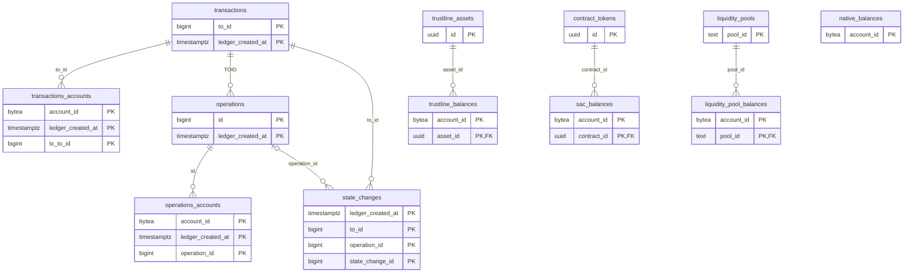

# Data model

For operators sizing storage and contributors writing queries. After reading, you can name every table, its keys, which process writes it, and which index serves which read.

## Contents

- [Hypertables](#hypertables)
- [Current-state tables](#current-state-tables)
- [Protocol tables](#protocol-tables)
- [Bookkeeping](#bookkeeping)
- [Indexes](#indexes)
- [Foreign keys and constraints](#foreign-keys-and-constraints)
- [Compression and retention](#compression-and-retention)
- [Where in the code](#where-in-the-code)

wallet-backend uses one PostgreSQL database with the TimescaleDB extension, and every table lives in the `public` schema. History tables are TimescaleDB hypertables partitioned by ledger close time. Current-state tables are plain PostgreSQL tables whose rows change in place as ledgers close. The SQL files in `internal/db/migrations/` define the schema. `wallet-backend migrate up` applies them; nothing applies them automatically.

Legend:

- The top five tables are hypertables. Their links are by ID only, with no foreign keys.
- `to_id` is a transaction's TOID. An operation's `id` encodes its parent transaction: `to_id = id & ~x'FFF'`.
- A state change with `operation_id` 0 is a fee change and has no operation.
- The bottom tables are current-state tables. Their links are real foreign keys, listed under [Foreign keys and constraints](#foreign-keys-and-constraints).
- Account addresses are stored as `BYTEA`.

## Hypertables

| Table | Partition column | Chunk interval (default) | segmentby | orderby | Sparse indexes | Purpose |
| --- | --- | --- | --- | --- | --- | --- |
| `transactions` | `ledger_created_at` | 1 day | Not set | `ledger_created_at DESC, to_id DESC` | `bloom(hash)` | One row per transaction: hash, fee charged, result code, ledger, fee-bump flag |
| `transactions_accounts` | `ledger_created_at` | 1 day | `account_id` | `ledger_created_at DESC, tx_to_id DESC` | None | Links each transaction to every account that took part in it |
| `operations` | `ledger_created_at` | 1 day | Not set | `ledger_created_at DESC, id DESC` | `bloom(operation_type)` | One row per operation: type, XDR, result code, success flag |
| `operations_accounts` | `ledger_created_at` | 1 day | `account_id` | `ledger_created_at DESC, operation_id DESC` | None | Links each operation to every account that took part in it |
| `state_changes` | `ledger_created_at` | 1 day | `account_id` | `ledger_created_at DESC, to_id DESC, operation_id DESC, state_change_id DESC` | `bloom(state_change_category)`, `bloom(state_change_reason)` | One row per change to an account: balances, signers, thresholds, flags, trustlines, data entries, allowances |

The chunk interval in the migrations is 1 day. On every start, the live ingester sets it again from `CHUNK_INTERVAL` (default `1 day`), which affects chunks created after that point.

`transaction_hashes` is a sixth hypertable with its own layout:

| Property | Value |
| --- | --- |
| Partition column | `hash_prefix`, in ranges 2^30 wide: 1,024 fixed chunks of 1,024 `hash_bucket` values each |
| `segmentby` / `orderby` | `hash_bucket, close_period` / `hash_prefix` |
| Columns | `hash_bucket` (top 20 bits of the prefix, an `INTEGER`; 1,048,576 buckets), `hash_prefix` (top 40 bits of the hash), `ledger_close_epoch` (close time in unix seconds), `close_period` (the close time in 30-day periods, generated from `ledger_close_epoch`; each compressed batch holds one bucket and one period, so retention deletes whole batches and recompression touches only the current period's) |
| Purpose | Finds a transaction's close time from its hash. One row per transaction, about 8.5 bytes per row including the rowstore index at today's density; batches fill at higher rates and the row gets smaller (6.14 bytes measured at 10k tx/s) |
| Chunk interval, compression and retention policies | Fixed chunks, no columnstore or retention policy. `CHUNK_INTERVAL`, `RETENTION_PERIOD` and the `COMPRESSION_*` settings do not apply. Maintenance jobs recompress every chunk and drop the rows of removed transactions, see [Compression and retention](#compression-and-retention) |

Every chunk keeps receiving rows, because a ledger's hashes spread over all of them.

Chunk skipping is on for these columns. It lets queries that filter on them skip whole chunks.

| Table | Chunk-skipping columns |
| --- | --- |
| `transactions` | `to_id`, `ledger_number` |
| `transactions_accounts` | `tx_to_id` |
| `operations` | `id` |
| `operations_accounts` | `operation_id` |
| `state_changes` | `to_id`, `operation_id` |

Each migration drops the single-column `ledger_created_at` index TimescaleDB creates by default. No query filters these tables by `ledger_created_at` alone.

## Current-state tables

| Table | Primary key | Purpose | Written by |
| --- | --- | --- | --- |
| `native_balances` | `account_id` | XLM balance, minimum balance, liabilities, subentry count per account | Both |
| `trustline_assets` | `id` (UUID v5 of `CODE:ISSUER`) | One row per classic asset. Unique on `(code, issuer)` | Both |
| `trustline_balances` | `(account_id, asset_id)` | Classic asset balance, limit, liabilities, flags per account | Both |
| `contract_tokens` | `id` (deterministic UUID) | Soroban token metadata: contract ID, type, code, issuer, name, symbol, decimals. Unique on `contract_id` | Both, and `protocol-setup` |
| `sac_balances` | `(account_id, contract_id)` | SAC balances held by contract addresses. Account holders keep these in `trustline_balances` | Both |
| `liquidity_pools` | `pool_id` | Constant-product pool reserves: two assets and their amounts | Both |
| `liquidity_pool_balances` | `(account_id, pool_id)` | Pool shares held per account | Both |

"Both" means the [checkpoint bootstrap](ingestion.md#checkpoint-bootstrap) fills the table on an empty database and the live ingester keeps it current every ledger. `protocol-setup` also writes `contract_tokens` when it classifies a SEP-41 contract and stores its metadata. Backfill does not write these tables. Balance and pool rows carry `last_modified_ledger`.

The balance and pool tables take upserts and deletes on most ledgers, so their storage settings favor in-place updates:

| Setting | Value | Tables |
| --- | --- | --- |
| `fillfactor` | 90 | `native_balances`, `trustline_balances`, `sac_balances`, `liquidity_pool_balances` |
| `fillfactor` | 80 | `liquidity_pools` |
| `autovacuum_vacuum_scale_factor` | 0.02 | All five |
| `autovacuum_analyze_scale_factor` | 0.01 | All five |
| `autovacuum_vacuum_threshold`, `autovacuum_analyze_threshold` | 50 | All five |
| `autovacuum_vacuum_cost_delay` | 0 | All five |

`trustline_assets` and `contract_tokens` keep the PostgreSQL defaults.

## Protocol tables

| Table | Primary key | Purpose | Written by |
| --- | --- | --- | --- |
| `protocols` | `id` | One row per registered protocol, with `classification_status`, `history_migration_status`, `current_state_migration_status` | `migrate up` and `protocol-setup` insert the row. `protocol-setup` and `protocol-migrate` set the status columns. |
| `protocol_wasms` | `wasm_hash` | Every WASM hash seen, with the protocol it matched (`protocol_id`, NULL if none) | Checkpoint bootstrap, live ingester, `protocol-setup` |
| `protocol_contracts` | `contract_id` | Contract-to-WASM mapping, plus an optional contract `name` | Checkpoint bootstrap, live ingester |
| `sep41_balances` | `(account_id, contract_id)` | Balances of SEP-41 tokens that are not SACs | SEP-41 processor: `protocol-migrate current-state`, then the live ingester |
| `sep41_allowances` | `(owner_id, spender_id, contract_id)` | Current SEP-41 allowances with amount and `expiration_ledger`. Readers hide rows whose `expiration_ledger` is below `latest_ingest_ledger` | SEP-41 processor: `protocol-migrate current-state`, then the live ingester |

SEP-41 history goes into `state_changes`, written by `protocol-migrate history` and then the live ingester. The live ingester writes a protocol's rows only after the protocol's cursor exists; see [Cursors](ingestion.md#cursors). `internal/db/migrations/protocols/001_sep41.sql` registers SEP-41 in `protocols`.

`sep41_balances` and `sep41_allowances` use the same storage settings as the balance tables, with `fillfactor` 90.

## Bookkeeping

`ingest_store` holds the cursors as `key` and `value` text columns, keyed on `key`.

| Key | Meaning | Written by |
| --- | --- | --- |
| `latest_ingest_ledger` | Last ledger the live ingester committed | Checkpoint bootstrap, live ingester |
| `oldest_ingest_ledger` | Lowest ledger the history tables cover | Checkpoint bootstrap, backfill, `reconcile_oldest_cursor` job |
| `protocol_<ID>_history_cursor` | Last ledger with protocol history written | `protocol-migrate history`, live ingester |
| `protocol_<ID>_current_state_cursor` | Last ledger with protocol current state written | `protocol-migrate current-state`, live ingester |

Other bookkeeping objects:

| Object | Kind | Created by | Role |
| --- | --- | --- | --- |
| `gorp_migrations` | Table | `migrate up` (sql-migrate) | One row per applied migration file |
| `refresh_updated_at_column` | Function | Migration | Trigger function that sets `updated_at` |
| `contract_tokens_set_updated_at` | Trigger | Migration | Runs `refresh_updated_at_column` on every `contract_tokens` update |
| `reconcile_oldest_cursor` | Function and TimescaleDB job | Live ingester, only when `RETENTION_PERIOD` is set | Raises `oldest_ingest_ledger` after retention drops chunks |

Protocol registration files in `internal/db/migrations/protocols/` are not tracked in `gorp_migrations`. They are idempotent and run on every `migrate up` and `protocol-setup`.

## Hash lookups

`transactions` is partitioned by time, and a hash says nothing about time. `transactionByHash` and the `transactionHash` filter on state changes read `transaction_hashes` first:

1. Compute `hash_bucket` and `hash_prefix` from the hash (`types.HashBytea.LookupKey`).
2. Find the close times stored for that `(hash_bucket, hash_prefix)`, newest first. The prefix selects exactly one chunk, so the lookup is planned and run on that chunk whatever the length of the history. A compressed chunk answers from its `hash_bucket` index, and the rows written since the last recompression answer from `idx_transaction_hashes_bucket_prefix`.
3. Read `transactions` in that close second, matching the full hash, as a second statement with the second written into it. The planner then expands only that one chunk; a single statement joining the two tables would be planned over every chunk of `transactions` on every lookup.

Two hashes can share the 40-bit prefix. Step 3 rejects the other one.

Measured on a pubnet history of 4.4 billion lookup rows and 988 daily `transactions` chunks:

| Step | Cold | Warm |
| --- | --- | --- |
| Step 2, lookup row (median) | 4.5 ms (max 6 ms): 7 pages read, 3 of them the compressed index | 0.16 ms |
| Step 2, planning | about 6 ms with the chunk's catalog cold | 0.85 ms |
| Step 3, `transactions` day still in the rowstore | 0.06 to 0.13 ms | |
| Step 3, `transactions` day compressed | 0.4 to 0.8 ms | |

Ingestion writes the lookup row in the same database transaction as the `transactions` row. The lookup table follows `transactions` through its maintenance jobs, so the lookup row of a transaction that retention dropped stays until the next retention pass. In that window step 3 finds nothing for a hash that step 2 found, and the lookup returns `null`. A database that already holds history when the migration runs has no lookup rows for it, and `transactionByHash` returns `null` for those transactions until that history is re-backfilled or filled with the one-off script in the [upgrade guide](../deploy/upgrading.md#filling-transaction_hashes-for-history-ingested-before-it-existed).

## Indexes

| Name | Table | Columns | Used by |
| --- | --- | --- | --- |
| Primary key | `transactions` | `to_id, ledger_created_at` | A transaction from its operation or state change (`TransactionModel.BatchGetByOperationIDs`, `BatchGetByStateChangeIDs`) |
| Primary key | `transactions_accounts` | `account_id, ledger_created_at, tx_to_id` | An account's transaction list (`TransactionModel.BatchGetByAccountAddress`) |
| Primary key | `operations_accounts` | `account_id, ledger_created_at, operation_id` | An account's operation list (`OperationModel.BatchGetByAccountAddress`, `BatchGetAccountOperationsByToIDs`) |
| Primary key | `state_changes` | `ledger_created_at, to_id, operation_id, state_change_id` | State changes of a transaction or operation (`BatchGetByToID`, `BatchGetByOperationID`, `BatchGetByOperationIDs`) |
| `idx_transaction_hashes_bucket_prefix` | `transaction_hashes` | `hash_bucket, hash_prefix` | Step 2 of a hash lookup (`TransactionModel.GetByHash`, and the transaction-hash filter on state changes), on the rows of a chunk written since its last recompression. Compressed batches use their own `hash_bucket` index |
| `idx_transactions_ledger_created_at` | `transactions` | `ledger_created_at` | Step 3 of a hash lookup (`TransactionModel.GetByHash`) on chunks still in the rowstore. Compressed chunks carry no B-tree and use batch metadata |
| `idx_transactions_accounts_tx_to_id` | `transactions_accounts` | `tx_to_id` | Accounts of a transaction (`AccountModel.BatchGetByToIDs`) |
| `idx_operations_accounts_operation_id` | `operations_accounts` | `operation_id` | Accounts of an operation (`AccountModel.BatchGetByOperationIDs`) |
| `idx_state_changes_account_id` | `state_changes` | `account_id, ledger_created_at DESC, to_id DESC, operation_id DESC, state_change_id DESC` | An account's state changes (`StateChangeModel.BatchGetByAccountAddress`, `BatchGetAccountStateChangesByToIDs`) |
| `idx_protocol_wasms_protocol_id` | `protocol_wasms` | `protocol_id` | Contracts of a protocol (`ProtocolContractsModel.GetByProtocolID`) |
| `idx_protocol_contracts_wasm_hash` | `protocol_contracts` | `wasm_hash` | Contracts by WASM (`ProtocolContractsModel.GetByWasmHashes`) |
| `idx_sep41_allowances_expiration_ledger` | `sep41_allowances` | `expiration_ledger` | Expired-allowance sweep (`AllowanceModel.DeleteExpiredBefore`) |
| `contract_tokens_contract_id_key` | `contract_tokens` | `contract_id` (unique) | One row per contract ID |
| `trustline_assets_code_issuer_key` | `trustline_assets` | `code, issuer` (unique) | One row per classic asset |

Category and reason filters on an account's state changes use `idx_state_changes_account_id` and then filter. Compressed chunks prune on the bloom sparse indexes. Every other primary key serves lookups by that key.

## Foreign keys and constraints

| Constraint | From | To | Deferred |
| --- | --- | --- | --- |
| `fk_trustline_asset` | `trustline_balances.asset_id` | `trustline_assets.id` | Yes, `DEFERRABLE INITIALLY DEFERRED` |
| `fk_contract_token` | `sac_balances.contract_id` | `contract_tokens.id` | Yes |
| `fk_sep41_contract_token` | `sep41_balances.contract_id` | `contract_tokens.id` | Yes |
| `fk_sep41_allowance_contract_token` | `sep41_allowances.contract_id` | `contract_tokens.id` | Yes |
| `liquidity_pool_balances_pool_id_fkey` | `liquidity_pool_balances.pool_id` | `liquidity_pools.pool_id` | Yes |
| `protocol_wasms_protocol_id_fkey` | `protocol_wasms.protocol_id` | `protocols.id` | No |
| `protocol_contracts_wasm_hash_fkey` | `protocol_contracts.wasm_hash` | `protocol_wasms.wasm_hash` | No |

The deferred foreign keys are checked at commit. Ingestion writes a balance and its parent in the same transaction, in either order.

The five hypertables have no foreign keys, to each other or to any other table. `native_balances`, `liquidity_pools`, `trustline_assets`, `contract_tokens`, and `ingest_store` have no outgoing foreign keys.

Check constraints:

| Table | Constraint |
| --- | --- |
| `operations` | `operation_type` is one of the 27 Stellar operation types, from `CREATE_ACCOUNT` to `RESTORE_FOOTPRINT` |
| `state_changes` | `state_change_category` is one of `BALANCE`, `ACCOUNT`, `SIGNER`, `SIGNATURE_THRESHOLD`, `DATA_ENTRY`, `HOME_DOMAIN`, `ALLOWANCE`, `FLAGS`, `TRUSTLINE`, `BALANCE_AUTHORIZATION` |
| `state_changes` | `state_change_reason` is one of `CREATE`, `MERGE`, `DEBIT`, `CREDIT`, `MINT`, `BURN`, `ADD`, `REMOVE`, `UPDATE`, `SET`, `CLEAR` |
| `contract_tokens` | `contract_tokens_sac_has_asset`: a row with `type = 'SAC'` has `code` and `issuer` set |
| `protocols` | Each status column is one of `not_started`, `in_progress`, `success`, `failed` |

## Compression and retention

The hypertables are created with the TimescaleDB columnstore on. TimescaleDB creates one compression policy per hypertable at that point. Compressed chunks are stored in columns, grouped by `segmentby` and sorted by `orderby` from the [Hypertables](#hypertables) table. TimescaleDB creates each policy with `compress_after` equal to the chunk interval, so a chunk becomes eligible one day after it closes unless `COMPRESSION_COMPRESS_AFTER` changes it (measured on TimescaleDB 2.28.2). This section covers the five bulk hypertables. `transaction_hashes` is covered below.

| Who | What it does |
| --- | --- |
| TimescaleDB compression job | Compresses closed chunks on its schedule. |
| Live ingester at startup | Changes the job's schedule, `compress_after`, and `maxchunks_to_compress` only when `COMPRESSION_SCHEDULE_INTERVAL`, `COMPRESSION_COMPRESS_AFTER`, or `COMPRESSION_MAX_CHUNKS` is set. |
| Backfill | Pauses every compression policy for the run and schedules them again at exit. Compresses the chunks it finished writing, for the five history tables and `transaction_hashes`, with `compress_chunk` on its own connections. Chunks that also hold live rows stay with the live policies. |

Retention is off unless `RETENTION_PERIOD` is set on the live ingester. With a value, every hypertable gets a retention policy that drops chunks older than that interval, and the `reconcile_oldest_cursor` job keeps `oldest_ingest_ledger` in step. With it empty, the live ingester removes any retention policy on start. Current-state, protocol, and bookkeeping tables are never compressed or dropped.

### Lookup table

`transaction_hashes` has no TimescaleDB columnstore or retention policy. Those policies act on a chunk's range of the partition column, and here that range is a range of hashes, not an age. The procedure `transaction_hashes_maintenance` does the work. It runs as N TimescaleDB jobs (default 1, every day). Each job takes the chunks whose prefix range index falls on its worker number, so a run finishes about N times faster. The migration creates the first job unscheduled. The live ingester schedules it at start and applies the settings: `TX_HASH_MAINTENANCE_INTERVAL` (default `1 day`) and `TX_HASH_MAINTENANCE_WORKERS` (default 1). They are the only settings it applies to this table. A database without a live ingester runs no maintenance.

Each run first deletes, from every chunk of its share, the rows of 30-day periods that closed before the floor. The floor is the older of two periods: the one of the oldest `transactions` row, and the retention cutoff, now minus the `drop_after` of the `transactions` retention policy. Without a retention policy nothing is ever dropped from `transactions`, so no lookup row is ever orphaned and the run deletes nothing. The cutoff bound protects a backfill: it lowers the oldest row while a run may be in progress, the run read its floor once at its start, and a backfill writes no row below the cutoff. A period is a `segmentby` column, so those are whole compressed batches: nothing is decompressed and no lock is taken (15 ms and 181 kB of WAL per chunk for three periods, measured). This is TimescaleDB's direct batch delete, `timescaledb.enable_compressed_direct_batch_delete`, on by default; leave it on. It then recompresses the chunk, folding the rows written since the last run from the rowstore part into the current period's batches (68 ms and 3.4 MB of WAL per chunk for a week of rows, measured, against 1.2 s and 31 MB when a batch spans a bucket's whole history). Measured on the live dev mainnet table (4.4 billion rows, 1,024 chunks) with a week of rows in the rowstore parts, 40 million: one worker 17 min 7 s and about 11.5 GB of WAL, eight workers 2 min 47 s and about 10 GB. Live ingestion ran at its baseline through both (per-ledger p99 480 to 640 ms, no lag) and lookups ran alongside. A run with minutes of rows takes under 4 minutes on one worker. A retention step on an 8-chunk copy of real rows: 6 to 13 ms and 490 kB of WAL per chunk for three periods, 3.5 million rows.

Retention follows `transactions` through that delete. A dropped transaction's lookup row stays until its whole 30-day period lies before the floor, so at most 30 days. With retention off there is no floor and no rows are removed; with no `transactions` row, or with job id 0, nothing is deleted. `RETENTION_PERIOD` itself applies to the five bulk tables only; the lookup table has no retention setting of its own.

Backfill writes lookup rows with the transactions. After every 500 million lookup rows written, and once at the end, it runs the procedure in recompression-only mode (job id 0) on its own connections, so its rows do not pile up in the rowstore parts.

Set the interval so the rows written between runs stay in the low hundreds of millions: at 10k tx/s that is a daily run on 8 workers.

See the [runbook](../deploy/runbook.md) for changing these settings on a running deployment, and [Ingestion](ingestion.md#timescaledb-policies-the-live-ingester-applies) for how they are applied.

### Scaling by transaction rate

Per-chunk figures times 1,024 chunks give the whole table. Today's column is measured on the live table. The 10k tx/s column is measured at that density on a dev table (4.86 billion rows over 8 chunks and 24 periods, 8 CPU, 32 GiB), then multiplied by 1,024 for whole-table figures.

| | Today's mainnet (5.7M tx/day) | 10k tx/s (864M tx/day) |
|---|---|---|
| Rows per bucket per 30-day period | 163 | 24,700 |
| Cold lookup, median | 2.7 ms | 46 ms (p90 62, max 68; 2 years, 24 periods) |
| Warm lookup | 0.16 ms | 0.6 ms |
| Recompression per chunk | 68 ms, 3.4 MB WAL (a week of rows) | 16.4 s, 327 MB WAL (daily, worst case) |
| Recompression, whole table, 1 worker | 17 min 7 s, about 11.5 GB WAL (a week of rows) | 4.7 h |
| Recompression, whole table, 8 workers | 2 min 47 s, about 10 GB WAL (a week of rows) | about 55 min, 170 to 335 GB WAL a day (6.5 to 13% of ingestion's own WAL) |
| Lookup write per ledger | no separate measurement | 191 ms median, 579 ms p99, 2.35 MB WAL (1.16 s p99 during a run) |
| Retention delete of one period, per chunk | 15 ms, 181 kB WAL (three periods) | 2.0 s, 125 MB WAL |
| Retention delete, whole table, every 30 days | not measured | about 34 min, 128 GB WAL |
| Table size | 35 GB, 8.5 bytes per row (4.4 billion rows) | 6.14 bytes per row |

Batches fill as the rate rises, so the row gets smaller: 8.5 bytes today, 6.14 measured at 10k tx/s. A batch stores `hash_prefix` in 1.1 KB and the close epoch in 4 KB of TOAST. The per-ledger write is the cost of the hash-keyed rowstore index, the same cost `idx_transactions_hash` carried; the lookup COPY runs inside the transactions sibling of the persist step. Rewrites leave free space in the compressed relations (28 to 36 GB after eight day-rewrites of 8 chunks). A per-chunk `VACUUM FULL` reclaims it, 14 minutes on the 4.4-billion-row dev table, with sub-second locks.

Eight recompression sessions ran for 10 minutes under inserts, lookups and chunk scans with 0 errors. Recompression takes only ShareUpdateExclusive locks on the chunk and its compressed relation, the inserter never waited on one, and the xmin pin is one chunk's transaction, about 60 s.

## Where in the code

| Path | Role |
| --- | --- |
| `internal/db/migrations/*.sql` | Schema: tables, hypertable options, indexes, constraints |
| `internal/db/migrations/protocols/` | Protocol registration SQL, run by `migrate up` and `protocol-setup` |
| `internal/db/migrate.go` | Runs migrations with sql-migrate |
| `internal/ingest/timescaledb.go` | Chunk interval, retention, compression settings, `reconcile_oldest_cursor` |
| `internal/data/transactions.go`, `operations.go`, `statechanges.go`, `accounts.go` | History table reads and `COPY` writes |
| `internal/data/*_balances.go`, `liquidity_pools.go`, `trustline_assets.go`, `contract_tokens.go` | Current-state table reads and writes |
| `internal/data/protocols.go`, `protocol_wasms.go`, `protocol_contracts.go` | Protocol table reads and writes |
| `internal/data/sep41/` | `sep41_balances` and `sep41_allowances` |
| `internal/data/ingest_store.go` | Cursor reads and writes |
